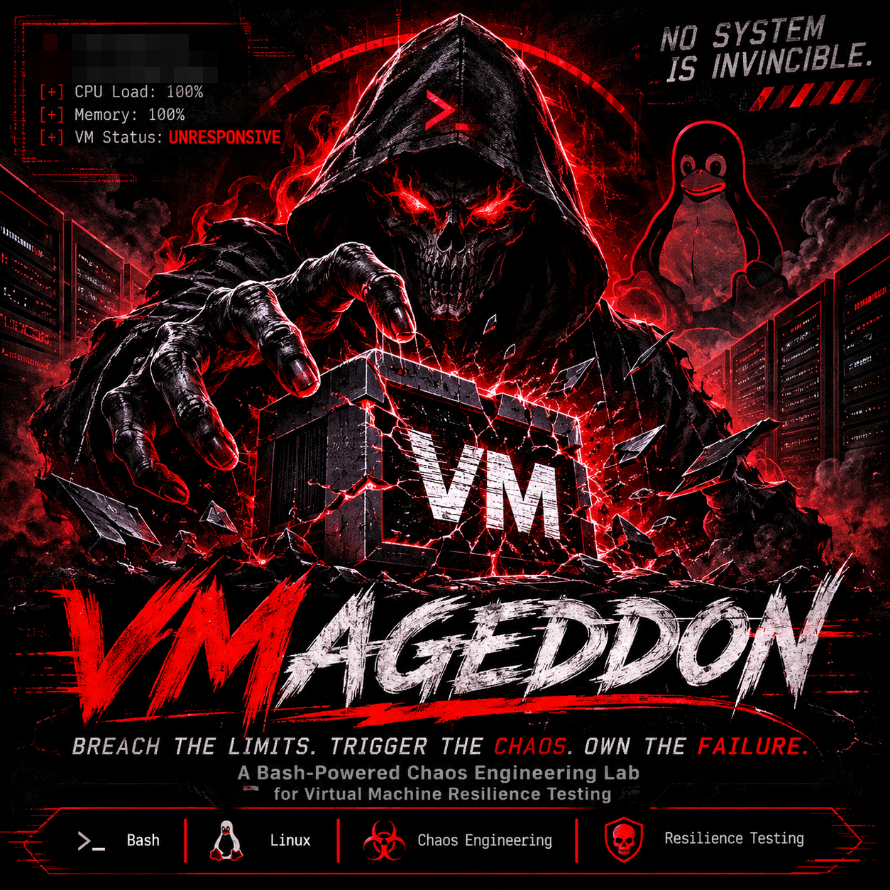

<h1 align="center">👻 VMageddon</h1>


<h3 align="center">
  ☠️ BREACH THE LIMITS. TRIGGER THE CHAOS. OWN THE FAILURE. ☠️
</h3>

<p align="center">
  <strong>
    An Underground Bash-Powered Chaos Lab for System Stress,
    Resource Exhaustion & Virtual Machine Failure Analysis.
  </strong>
</p>


<p align="center">
  
  
  
  
</p>

---

## 💀 What is VMageddon?

**VMageddon** is an experimental Chaos Engineering project designed to explore how Linux virtual machines behave under resource pressure.

The project uses Bash and Linux processes to simulate resource contention, introduce controlled CPU stress, allocate memory, and observe system behavior.

The main goal is to understand system resilience, resource exhaustion, process management, and recovery mechanisms.

**Don't just monitor the system. Understand how it fails.**

## 🔥 Features

- ⚡ CPU Stress Simulation
- 🧠 Memory Pressure Simulation
- 👻 Process Lifecycle Management
- 📊 System Resource Monitoring
- ⏱️ Configurable Experiment Duration
- 🛡️ Automatic Process Cleanup
- 🔄 Recovery-Oriented Testing

## 🧪 How It Works

VMageddon performs controlled stress experiments through several stages:

| Stage | Description |
|---|---|
| 01 | Initialize the experiment |
| 02 | Launch CPU-intensive workers |
| 03 | Allocate bounded memory |
| 04 | Observe system resource usage |
| 05 | Stop experimental processes |
| 06 | Evaluate system recovery |

## ⚙️ Requirements

- Linux-based virtual machine
- Bash
- Python 3
- `timeout` utility
- `procps` utilities (`free`, `uptime`)
- Permission to execute shell scripts

## 🚀 Installation

Clone the repository:

```bash
git clone https://github.com/SilentSpectre-arch/VMageddon.git
```

Enter the project directory:

```bash
cd VMageddon
```

Make the script executable:

```bash
chmod +x vmageddon.sh
```

Run the experiment:

```bash
./vmageddon.sh
```

## 🎛️ Configuration

The experiment parameters can be adjusted inside the script.

```bash
DURATION=1000000000
CPU_WORKERS=1000000000
MEMORY_MB=1000000000
```

| Parameter | Description |
|---|---|
| `DURATION` | Experiment duration in seconds |
| `CPU_WORKERS` | Number of CPU stress workers |
| `MEMORY_MB` | Memory allocation limit in MB |

All parameters should be selected according to available VM resources and host capacity.

## 📈 Monitoring

During the experiment, Linux system utilities can be used to observe resource consumption.

Check CPU and process activity:

```bash
top
```

Check memory usage:

```bash
free -h
```

Check system load:

```bash
uptime
```

Inspect running processes:

```bash
ps aux --sort=-%cpu | head
```

## 🛡️ Safety & Recovery

VMageddon is intended exclusively for isolated, authorized testing environments.

**Important precautions:**

- Take a VM snapshot before testing.
- Never run experiments on production systems.
- Keep sufficient resources available on the host.
- Avoid unbounded memory or process allocation.
- Ensure access to the hypervisor console.
- Verify cleanup and recovery after each experiment.

The current implementation uses bounded memory allocation and timed CPU workers. It does not guarantee that a VM will become unresponsive.

## ⚠️ Disclaimer

This project is intended for educational purposes and authorized laboratory experiments only.

The author is not responsible for data loss, system instability, or damage caused by improper use.

**Use isolated virtual machines and maintain recoverable snapshots.**

---

<p align="center">
  👻 <strong>VMageddon</strong>
  <br/>
  <i>Every system has a breaking point.</i>
</p>